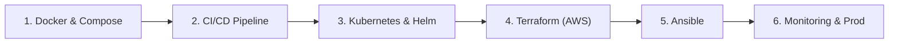

# 📦 Cloud Orders Service (DevOps Practice Project)

> **Легенда проекта:**  
> Команда разработчиков передала вам сервис заказов (**Cloud Orders API**). Ваша задача как **Junior DevOps инженера** — забрать этот сервис и построить для него весь цикл поставки и эксплуатации: от локального запуска и Docker-контейнеризации до облачной инфраструктуры в AWS и мониторинга.

---

## 🏗 Архитектура приложения

Приложение построено в соответствии с принципами **12-Factor App**:
- **Язык/Фреймворк:** Python 3.11+ / FastAPI (асинхронный REST API)
- **База данных:** PostgreSQL (ORM SQLAlchemy)
- **Кэш:** Redis (кэширование списков заказов, сброс кэша при мутациях)
- **Метрики:** Prometheus метрики встроены из коробки (`/metrics`)
- **Пробы:** Liveness и Readiness эндпоинты для Kubernetes (`/health/live`, `/health/ready`)
- **Конфигурация:** Через переменные окружения (`.env` или ConfigMap/Secrets)
- **Тесты:** Набор автоматических тестов на `pytest`

### Эндпоинты API:
| Метод | Путь | Описание | DevOps значение |
|---|---|---|---|
| `GET` | `/` | Приветствие и базовая информация | Smoke test |
| `GET` | `/api/v1/info` | Имя пода, версия, среда (`dev/stage/prod`) | Проверка Rolling Update / Балансировки |
| `GET` | `/health/live` | Проверка живости процесса (Liveness probe) | Для `livenessProbe` в K8s |
| `GET` | `/health/ready` | Проверка связи с БД и Redis (Readiness) | Для `readinessProbe` в K8s |
| `GET` | `/metrics` | Метрики приложения в формате Prometheus | Для Prometheus & Grafana |
| `POST` | `/api/v1/orders` | Создание заказа | Бизнес-логика (запись в БД) |
| `GET` | `/api/v1/orders` | Список заказов | Бизнес-логика (чтение из Redis/БД) |
| `GET` | `/api/v1/orders/{id}` | Детали заказа | Бизнес-логика |
| `PATCH`| `/api/v1/orders/{id}` | Обновление статуса/количества | Бизнес-логика |
| `DELETE`| `/api/v1/orders/{id}`| Удаление заказа | Бизнес-логика |
| `GET` | `/docs` | Swagger UI документация | Тестирование вручную |

---

## 🗺 Пошаговый Роадмап практики DevOps

Здесь расписаны шаги, которые вам предстоит реализовать самостоятельно.



---

### Этап 1: Контейнеризация (Docker & Docker Compose)
**Цель:** Научиться упаковывать приложение и зависимости в надежный и легковесный контейнер.

1. **Создайте `.dockerignore`**:
   - Исключите `__pycache__`, `.venv`, `.git`, `.env`, тесты и временные файлы.
2. **Напишите `Dockerfile`**:
   - Используйте multi-stage сборку (`python:3.11-slim`) для минимизации размера и безопасности.
   - Не запускайте приложение от `root`! Создайте пользователя без прав администратора (`appuser`).
   - Используйте правильную форму команды запуска (`CMD ["uvicorn", ...]`).
3. **Напишите `docker-compose.yml`**:
   - Сервис `api` (ваше приложение).
   - Сервис `postgres` (образ `postgres:16-alpine`, volumes для персистентности данных, переменные `POSTGRES_DB`, `POSTGRES_USER`, `POSTGRES_PASSWORD`).
   - Сервис `redis` (образ `redis:7-alpine`).
   - Настройте `depends_on` с `condition: service_healthy` (healthcheck для postgres и redis).
   - Проверьте запуск: `docker compose up --build`.

---

### Этап 2: CI/CD Pipeline (GitHub Actions / GitLab CI)
**Цель:** Автоматизировать проверку кода и сборку артефактов при каждом коммите.

1. Создайте репозиторий на GitHub / GitLab.
2. Реализуйте pipeline (`.github/workflows/ci.yml`):
   - **Job 1 (Lint):** Проверка стиля кода с помощью `flake8` или `black`.
   - **Job 2 (Test):** Установка зависимостей из `requirements-dev.txt` и запуск тестов: `pytest -v`.
   - **Job 3 (Build & Push):** Если тесты прошли успешно:
     - Логин в реестр контейнеров (Docker Hub или AWS ECR).
     - Сборка Docker-образа с тегами `sha` коммита и `latest`.
     - Сканирование уязвимостей образа (например, через `trivy`).
     - Push образа в реестр.

---

### Этап 3: Kubernetes & Helm
**Цель:** Развернуть приложение в оркестраторе с отказоустойчивостью и масштабированием.

1. **Создайте K8s манифесты (`k8s/`):**
   - `namespace.yaml` — изолированное пространство имен (например, `orders-dev`).
   - `configmap.yaml` — параметры окружения (`APP_ENV`, `LOG_LEVEL`, `DB_HOST`, `DB_PORT`).
   - `secret.yaml` — учетные данные к БД (base64).
   - `deployment.yaml`:
     - Количество реплик: `3`.
     - `resources.requests` и `resources.limits` (CPU, Memory).
     - `livenessProbe` на путь `/health/live` (port: 8000).
     - `readinessProbe` на путь `/health/ready` (port: 8000).
   - `service.yaml` — тип `ClusterIP`.
   - `ingress.yaml` — маршрутизация входящего HTTP-трафика к сервису.
   - `hpa.yaml` — горизонтальное масштабирование (`HorizontalPodAutoscaler`) по утилизации CPU (min: 2, max: 10).
2. **Helm Chart (`helm/orders-service`):**
   - Переведите манифесты в Helm Chart с параметризацией через `values.yaml` для легкого деплоя в разные окружения (dev, stage, prod).

---

### Этап 4: Инфраструктура как Код (Terraform в AWS)
**Цель:** Описать всю облачную инфраструктуру кодом с воспроизводимым результатом.

1. **Подготовьте структуру каталога `terraform/`**:
   - `main.tf`, `variables.tf`, `outputs.tf`, `providers.tf`.
   - Настройте Remote Backend: S3 бакет для `terraform.tfstate` и DynamoDB таблица для блокировок (state locking).
2. **Ресурсы для создания в AWS:**
   - **VPC Module:** 
     - 2 публичные подсети (Public Subnets).
     - 2 приватные подсети (Private Subnets).
     - Internet Gateway и NAT Gateway.
   - **Security Groups:** 
     - SG для балансировщика (порты 80, 443 наружу).
     - SG для приложения (доступ только от балансировщика).
     - SG для базы данных (доступ только от приложения на порт 5432).
   - **Database:** AWS RDS PostgreSQL (в приватных подсетях) или инстанс с БД.
   - **Compute:** Либо EKS (Elastic Kubernetes Service), либо EC2 инстансы с ASG (Auto Scaling Group) для минимизации расходов.
   - **Container Registry:** AWS ECR репозиторий.

---

### Этап 5: Управление Конфигурацией (Ansible)
**Цель:** Автоматизировать настройку операционной системы серверов.

1. Создайте структуру `ansible/`:
   - `inventory/hosts.ini` (список серверов / EC2 инстансов).
   - `playbooks/setup_nodes.yml`:
     - Обновление пакетов ОС (Ubuntu / Amazon Linux).
     - Настройка безопасности: базовый firewall (`ufw`), запрет логина по паролю по SSH.
     - Установка Docker и Docker Compose (или установка легкого Kubernetes `k3s`).
     - Создание системного пользователя для деплоя.
     - Установка утилит диагностики (`htop`, `curl`, `jq`, `net-tools`).

---

### Этап 6: Деплой, Мониторинг и Наблюдаемость (Observability)
**Цель:** Убедиться, что сервис стабильно работает, и вы видите, что с ним происходит.

1. Настройте сбор метрик:
   - Prometheus скрейпит эндпоинт `/metrics` вашего сервиса каждые 15 секунд.
   - Импортируйте или создайте в Grafana дашборд с графиками:
     - RPS (запросы в секунду),
     - Latency (p95, p99 задержки ответов),
     - HTTP Status Codes (2xx, 4xx, 5xx),
     - Использование памяти и CPU подами.
2. Настройте централизованный сбор логов:
   - FluentBit / Promtail -> Loki / CloudWatch.
3. Проведите нагрузочное тестирование (Chaos / Stress testing):
   - Утилитой `k6` или `wrk` дайте нагрузку на эндпоинты `/api/v1/orders`.
   - Посмотрите, как HPA поднимает дополнительные поды.
   - Искусственно "уроните" БД и проверьте, как K8s readinessProbe снимает трафик с подов.

---

## 🚀 Быстрый старт для проверки разработчиками (Локальный запуск)

### 1. Создание виртуального окружения и установка
```bash
python3 -m venv .venv
source .venv/bin/activate
pip install -r requirements.txt
pip install -r requirements-dev.txt
```

### 2. Запуск тестов
```bash
pytest -v
```

### 3. Локальный запуск (с использованием встроенного SQLite):
```bash
USE_SQLITE=true REDIS_ENABLED=false uvicorn app.main:app --reload --port 8000
```
После запуска откройте в браузере:
- Документация API: [http://localhost:8000/docs](http://localhost:8000/docs)
- Проверка здоровья: [http://localhost:8000/health](http://localhost:8000/health)
- Метрики: [http://localhost:8000/metrics](http://localhost:8000/metrics)
- Инфо о поде: [http://localhost:8000/api/v1/info](http://localhost:8000/api/v1/info)

---

## 🎯 Что положить в портфолио / резюме по итогам:
Когда вы пройдете этот путь, у вас в GitHub будет эталонный пет-проект:
- `app/` — исходный код микросервиса.
- `Dockerfile` & `docker-compose.yml` — контейнеризация.
- `.github/workflows/` — готовый CI/CD pipeline.
- `k8s/` и `helm/` — манифесты и Helm-чарты.
- `terraform/` — описание облака AWS (IaC).
- `ansible/` — плейбуки настройки серверов.
- Скриншоты дашборда Grafana с метриками вашего приложения под нагрузкой.
